# Studora

Studora is a study partner for university students. This repository contains the Next.js frontend prototype and its local study workspace.

## Preview

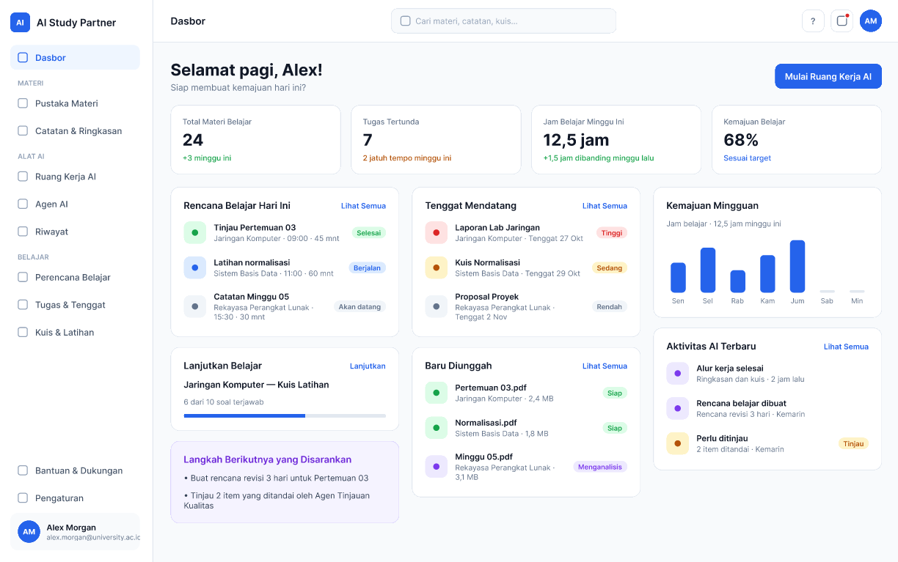

<sub>Dashboard preview using the built-in sample learning pack. The screenshots below show the current interface; study data in the prototype is stored locally in the browser.</sub>

<details>
<summary>Explore the dark theme, global AI assistant, and all 12 other pages</summary>

### Global AI assistant

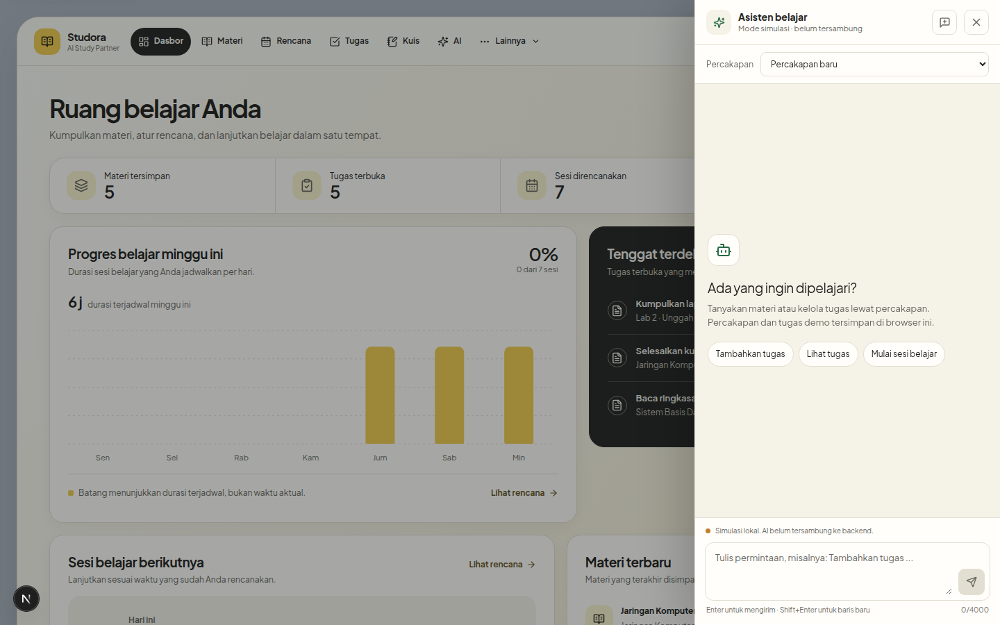

### Dashboard — dark theme

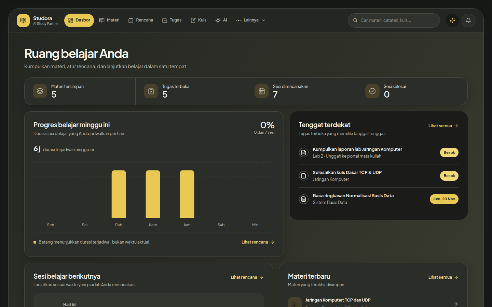

<table>
  <tr>
    <td width="50%"><strong>Material library</strong><br>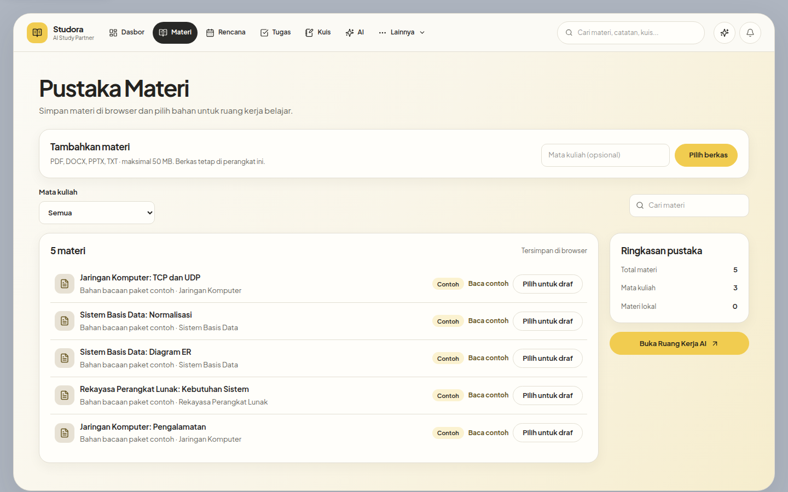</td>
    <td width="50%"><strong>AI study workspace</strong><br>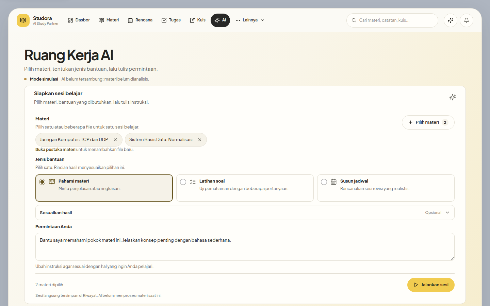</td>
  </tr>
  <tr>
    <td width="50%"><strong>Study planner</strong><br>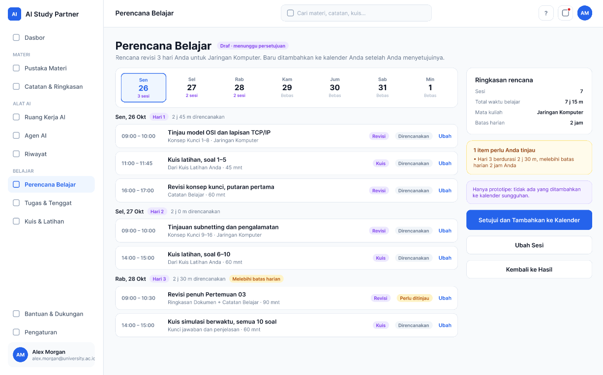</td>
    <td width="50%"><strong>Tasks and deadlines</strong><br>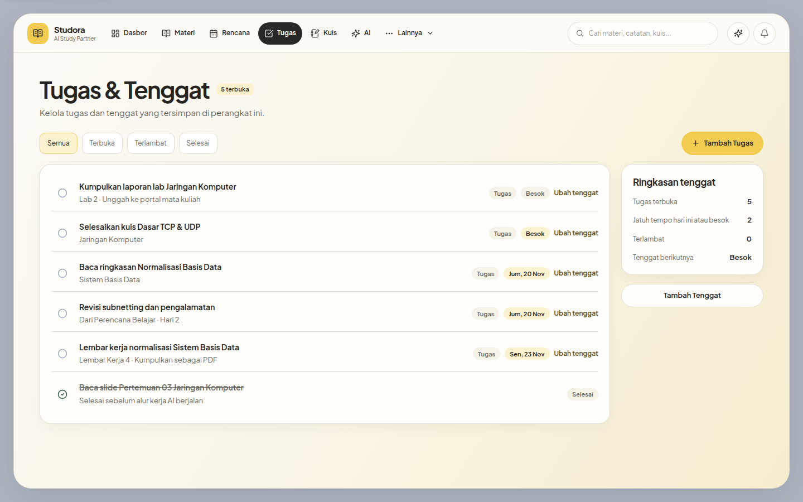</td>
  </tr>
  <tr>
    <td width="50%"><strong>Quizzes and exercises</strong><br>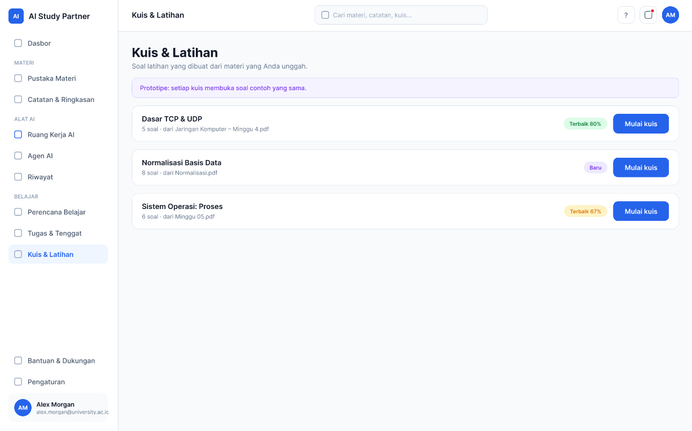</td>
    <td width="50%"><strong>Notes and summaries</strong><br>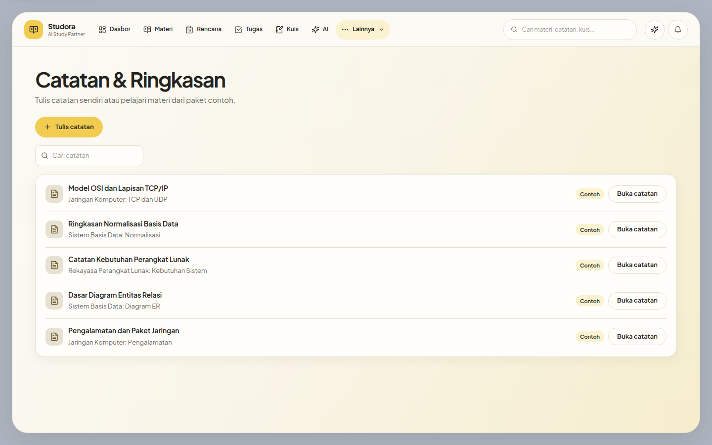</td>
  </tr>
  <tr>
    <td width="50%"><strong>AI agents</strong><br>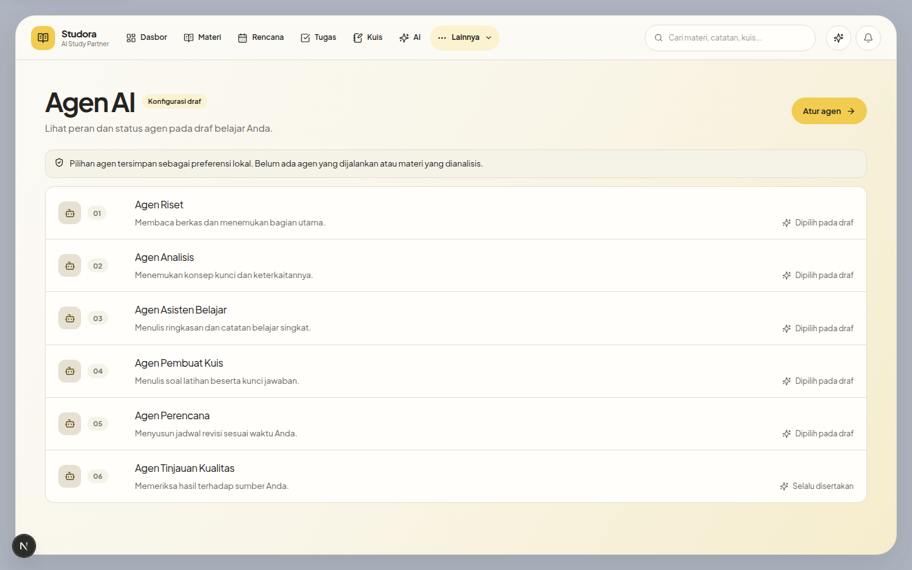</td>
    <td width="50%"><strong>Study history</strong><br>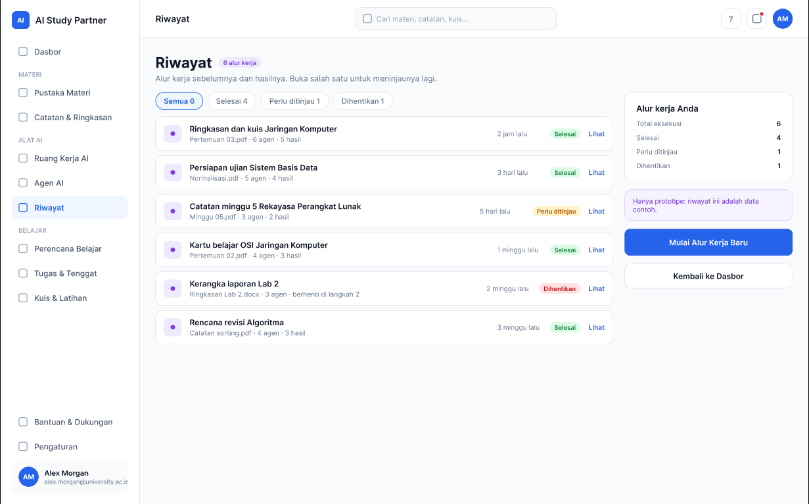</td>
  </tr>
  <tr>
    <td width="50%"><strong>Notifications</strong><br>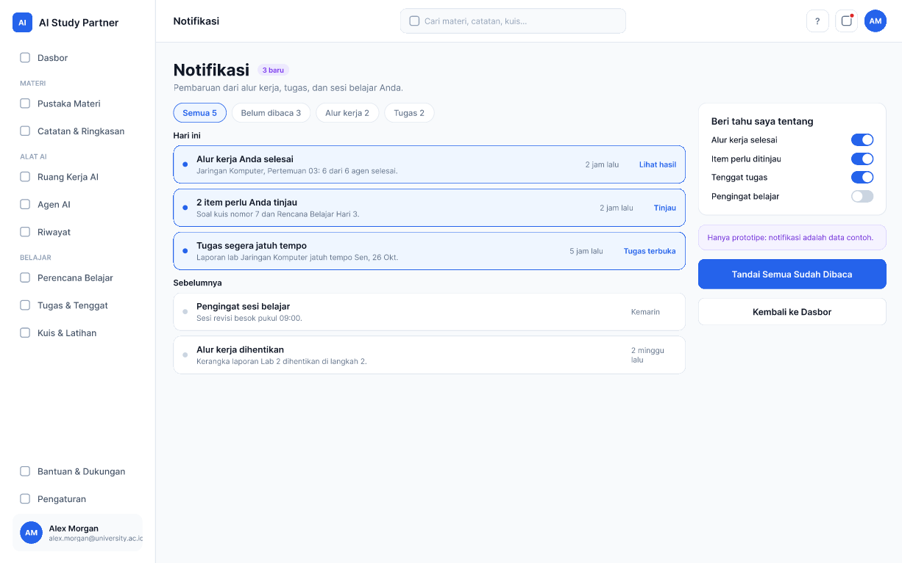</td>
    <td width="50%"><strong>Settings</strong><br>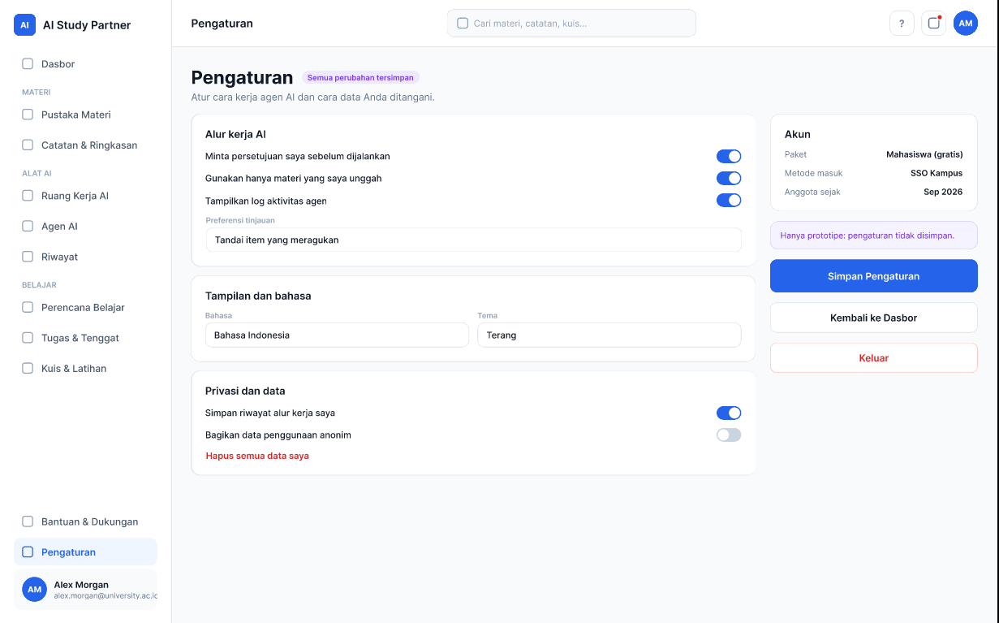</td>
  </tr>
  <tr>
    <td width="50%"><strong>Help and support</strong><br>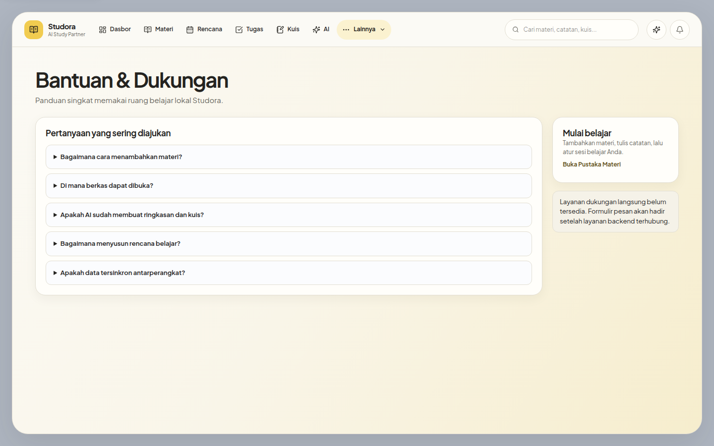</td>
    <td width="50%"><strong>Account access</strong><br>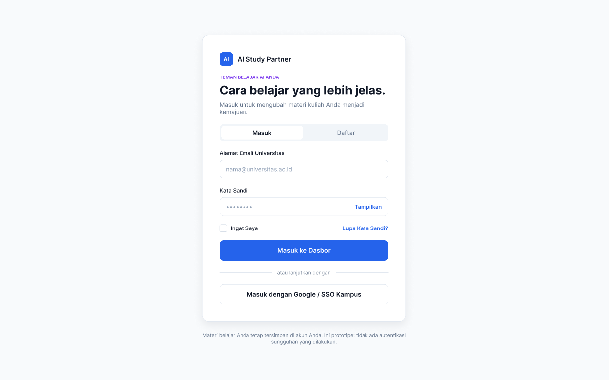</td>
  </tr>
</table>

</details>

## Run locally

Requirements: Node.js 20.9 or newer and npm.

```bash
npm install
npm run dev
```

Open [http://localhost:3000](http://localhost:3000).

## Current capabilities

- Import PDF, DOCX, PPTX, and TXT materials up to 50 MB. Files stay in this browser and are stored in IndexedDB.
- Write notes, take the authored sample quizzes, manage study sessions and task deadlines, and review local progress.
- Load or remove the optional sample learning pack from the Materials page.

Study data is stored in this browser and does not sync between devices. Authentication, AI generation, cloud storage, calendar sync, and live support are not connected yet. Workspace drafts save the selected material and learning preferences; they do not analyze uploaded files.

## Checks

```bash
npx playwright install chromium
npm run typecheck
npm run build
npm run test:e2e
```
